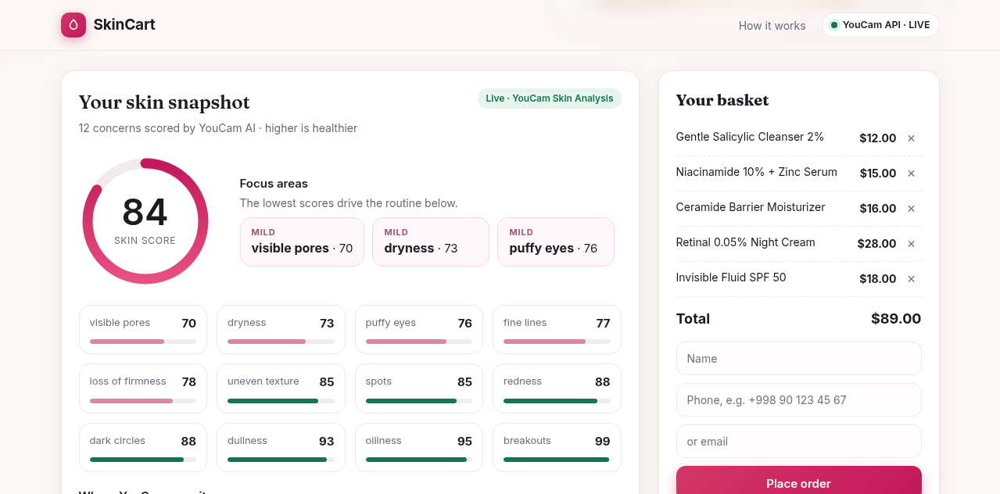
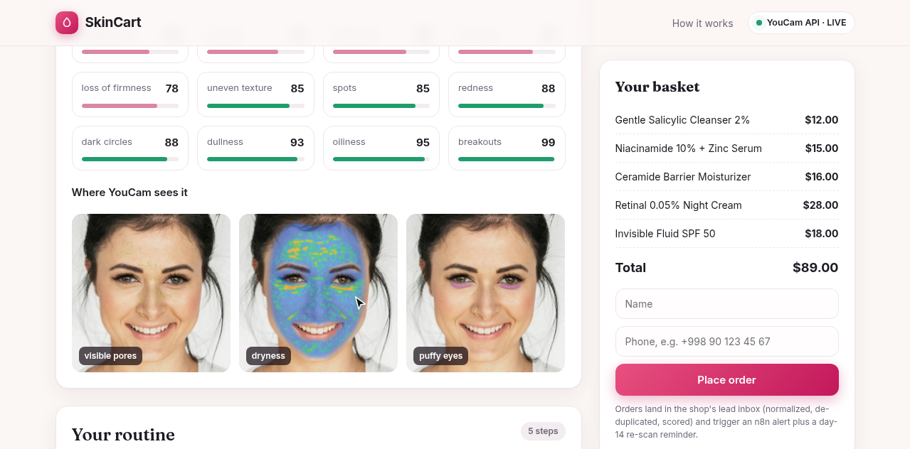
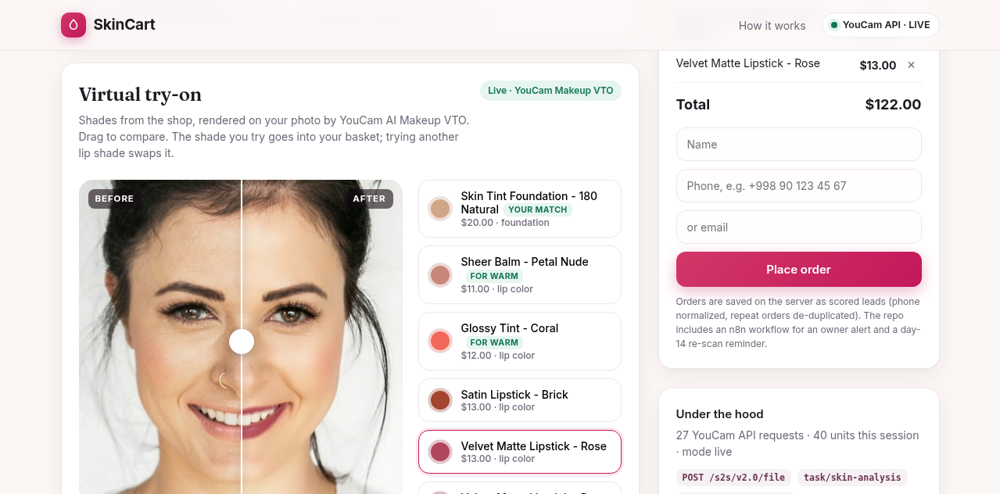
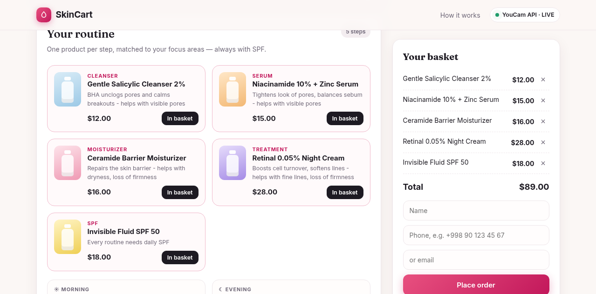
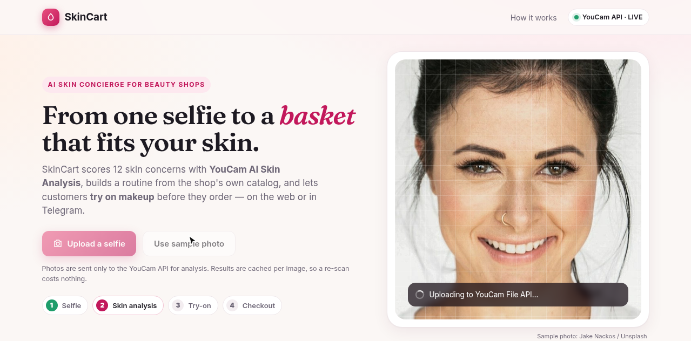
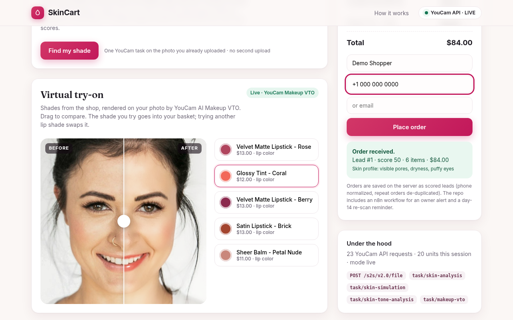
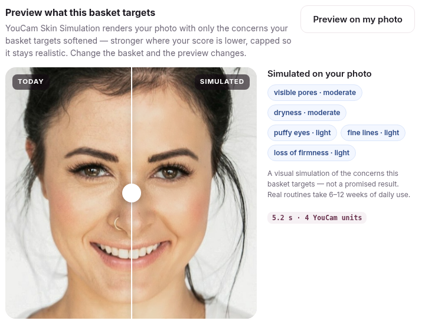
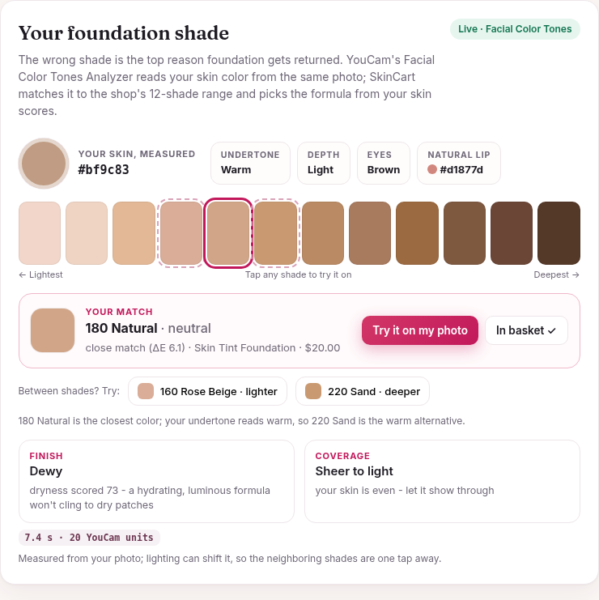
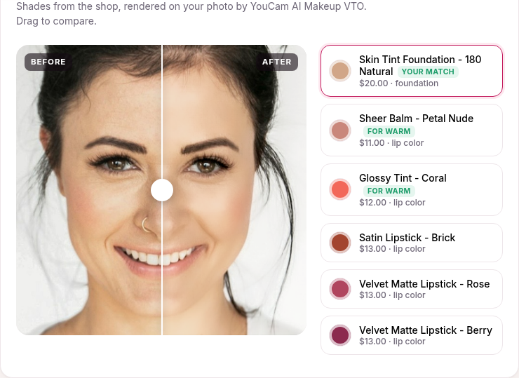
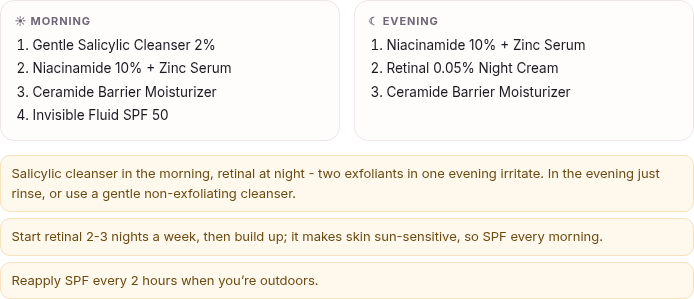

# SkinCart 💄 — selfie-to-basket beauty assistant on YouCam AI

**YouCam API Skin AI & eCommerce VTO Hackathon** · MIT · Built by heavycastles

**Live demo:** https://skincart-youcam.vercel.app (no login; press "Use sample photo", or upload your own selfie)

The public demo runs the web flow on the live YouCam API (analysis, simulation, shade match, try-on, order saved as a
scored lead). The Telegram bot and the n8n workflow are in the repo and run with `docker compose`; the page only claims
them when they are connected (`/version` reports `telegram` and `n8n`).

**YouCam APIs used:** AI Skin Analysis · AI Skin Simulation · AI Facial Color Tones Analyzer · AI Makeup VTO — all on one
File API upload (`file_id`). **Demo video (2:30):** https://youtu.be/NIFuCn8lOT0 (also [`docs/demo-v4.mp4`](docs/demo-v4.mp4)).

Own photos go through a quick **framing step** (zoom/drag so the face fills the oval), because YouCam Skin Analysis
needs the face to cover more than 60% of the photo width. Photos are checked before any API call (JPG/PNG, at least
480 px on the short side), and YouCam errors such as "face too small", "no face" or "too dark" come back as plain advice.

Small cosmetics shops in Central Asia/CIS sell mostly through Telegram and Instagram DMs, and answer
"what should I buy for my skin?" by hand. **SkinCart** turns that into a bot:

1. Customer sends a selfie to the shop's **Telegram bot** (or the web page).
2. **YouCam AI Skin Analysis API** scores 12 concerns (acne, pores, wrinkles, texture, moisture, oiliness,
   redness, radiance, dark circles, spots, eye bags, firmness).
3. A matcher builds a routine from the shop's **catalog** (one product per category, weighted by need, always SPF)
   and a **morning / evening plan** that handles ingredient clashes (retinal at night → salicylic cleanser in the
   morning, vitamin C under SPF, "no SPF" warning). It updates when the basket changes.
4. **YouCam AI Skin Simulation** — "Preview what this basket targets": the customer's own photo with only the
   concerns targeted by the basket's products softened (intensity 0.25–0.7 from the score, concerns below the
   healthy line only). Change the basket, and the preview changes. Labelled as a simulation, not a promise.
5. **YouCam AI Facial Color Tones Analyzer** — "Find my foundation shade": skin / lip / eye color from the same
   upload → undertone (CIELAB hue angle) and depth (ITA) → nearest of the shop's 12 foundation shades (delta-E,
   undertone-aware) + lighter / deeper neighbors → finish and coverage from the Skin Analysis scores (dry → dewy,
   oily → matte, visible redness/spots → more coverage). Lip shades are re-ranked for the undertone.
6. **YouCam AI Makeup VTO**: try the matched foundation (or a neighbor) and the shop's lipsticks on the same selfie.
7. "Order" → contact → saved as a **LeadFlow lead** (normalized, de-duplicated, scored, with `skin_profile` + `basket`)
   → optional **n8n** workflow notifies the shop owner and sends a 14-day "re-scan your skin" follow-up.

## Screenshots (live YouCam API, production demo, retaken 24 Oct 2026)

Taken from https://skincart-youcam.vercel.app with the live YouCam API and a licensed stock portrait
(Jake Nackos / Unsplash, see `docs/stock-face/`).

| Skin snapshot | YouCam overlay masks |
|---|---|
|  |  |
| **Makeup try-on (before / after)** | **Routine + basket** |
|  |  |
| **Upload + scan** | **Order saved as a lead** |
|  |  |

Skin Simulation, shade match and the morning / evening plan (same live run):

| Skin Simulation of what the basket targets | Foundation shade match (Facial Color Tones) |
|---|---|
|  |  |
| **Matched foundation on the photo (Makeup VTO)** | **Morning / evening plan** |
|  |  |

## Architecture

```
Telegram bot ──┐
               ├──► FastAPI  POST /analyze · /simulate · /shade · /tryon · /orders
Web demo ──────┘         │
                         ├─ YouCam client   File API (one file_id) → Skin Analysis · Skin Simulation
                         │                  · Facial Color Tones · Makeup VTO
                         ├─ recommend.py + catalog.json (routine, AM/PM plan, simulation intensities)
                         ├─ shade.py (CIELAB / ITA shade match, formula, lip ranking)
                         ├─ LeadStore (normalize / de-dupe / score + extra)
                         └─ n8n webhook (owner alert + day-14 re-scan)
```

Without `YOUCAM_API_KEY` (or with `YOUCAM_MOCK=1`) the client returns deterministic mock scores and a synthetic
SVG try-on preview — tests and demos run offline. Results are cached per image hash so re-scans cost 0 units, and
each photo is uploaded once: its `file_id` is reused by every task (simulation, color tones, try-ons). Every
response carries `units` (YouCam units spent; 0 when cached) and the page totals them. `GET /sample.jpg` serves the licensed stock
portrait behind the "Use sample photo" button.

## Run

```bash
cp .env.example .env               # optional: YOUCAM_API_KEY, TELEGRAM_BOT_TOKEN
python -m venv .venv && .venv/bin/pip install -r requirements-dev.txt
.venv/bin/pytest -q                # 101 tests (offline mock)
.venv/bin/python serve.py          # http://localhost:8080  (mock mode if no key)
docker compose up --build          # app :8080 + n8n :5678 (import n8n/skincart-orders.json)
```

Live mode: put `YOUCAM_API_KEY` (from https://yce.makeupar.com/api-console/en/api-keys/) into `.env`.
Smoke-test one real call: `YOUCAM_API_KEY=... PYTHONPATH=. python scripts/live_smoke.py selfie.jpg`
(use only your own or consented / licensed photos).

Telegram: set `TELEGRAM_BOT_TOKEN` and either register a webhook to `https://<host>/telegram/webhook`
(optionally with `TELEGRAM_WEBHOOK_SECRET`) or run long polling: `python -m app.telegram`.

## Environment variables

All optional — with none set, the app runs fully offline in mock mode. Copy `.env.example` to `.env` (gitignored).

| Variable | Example | Purpose |
|---|---|---|
| `YOUCAM_API_KEY` | `your-youcam-api-key` | YouCam API key ([API console](https://yce.makeupar.com/api-console/en/api-keys/)); empty = mock mode |
| `YOUCAM_MOCK` | `1` | Force mock mode even when a key is set (saves units) |
| `YOUCAM_BASE_URL` | `https://yce-api-01.makeupar.com` | YouCam API server |
| `YOUCAM_TIMEOUT` | `40` | Seconds one request may spend on YouCam before giving up (default 40 on Vercel, 120 elsewhere) |
| `TELEGRAM_BOT_TOKEN` | `123456:your-bot-token` | Telegram bot (webhook or `python -m app.telegram` long polling) |
| `TELEGRAM_WEBHOOK_SECRET` | `change-me` | Checked against Telegram's secret-token header on `/telegram/webhook` |
| `OWNER_CHAT_ID` | `123456789` | Shop owner's Telegram chat, notified by the n8n workflow about new orders |
| `N8N_WEBHOOK_URL` | `http://n8n:5678/webhook/skincart-order` | Order hand-off to the n8n workflow |
| `ADMIN_TOKEN` | `long-random-string` | Enables admin-only `/leads` (header `X-Admin-Token`); unset = 404 |
| `PORT` | `8080` | Local server port (`serve.py`) |

Never commit `.env` or the API key.

## YouCam API usage (`app/youcam.py`)

| Step | Call |
|---|---|
| Auth | `Authorization: Bearer $YOUCAM_API_KEY`, server `https://yce-api-01.makeupar.com` |
| Upload | `POST /s2s/v2.0/file` → `file_id` + presigned `PUT` URL → upload bytes (key is never sent to the bucket) |
| Skin analysis | `POST /s2s/v2.0/task/skin-analysis` `{src_file_id, dst_actions[12 SD], format:"json"}` → poll `GET …/{task_id}` → `results.output[].ui_score` |
| Skin Simulation | `POST /s2s/v2.0/task/skin-simulation` `{src_file_id, pores:0.4, texture:0.35, wrinkle:0.3, …}` (only concerns the basket targets; `oiliness` is left out because that knob adds shine) → poll → `results.url` |
| Facial Color Tones | `POST /s2s/v2.0/task/skin-tone-analysis` `{src_file_id, face_angle_strictness_level:"medium"}` → poll → `results.color.{skin_color, lip_color, eye_color_name}` (hair color is ignored: it was wrong on our test face) |
| Makeup VTO | `POST /s2s/v2.0/task/makeup-vto` `{src_file_id, effects:[lip_color/foundation], version:"1.0"}` → poll → result URL |

Units per successful task (from `GET /s2s/v2.0/credit/feature-cost`, Oct 2026): Skin Analysis SD 9–12 concerns 14 ·
Skin Simulation 4 (1–4 concerns) / 6 (5–10) · Facial Color Tones 20 · Makeup VTO 1. Failed tasks cost nothing.
A full first visit with the sample photo is 39 units; repeat visits on a warm instance are 0.

## API

| Method | Path | |
|---|---|---|
| GET | `/` | web demo |
| POST | `/analyze` | `{image_base64\|image_url}` → scores, basket, try-on SKUs (a link is downloaded once, public hosts only, then checked like an upload) |
| POST | `/simulate` | `{scan_id, skus, scores?}` → Skin Simulation image URL + intensities + targeted concerns |
| POST | `/shade` | `{scan_id, scores?}` → skin/lip color, undertone, depth, matched shade + neighbors + 12-shade range, finish/coverage, ranked lip shades |
| POST | `/tryon` | `{scan_id, sku}` → VTO image URL (lip shades and any foundation shade) |
| POST | `/orders` | `{scan_id, name, phone\|email, skus}` → order receipt (this order only; contacts are never echoed back) |
| GET | `/catalog` · `/healthz` · `/version` | public |
| GET | `/leads`, `/leads/{id}` | admin only: header `X-Admin-Token` = `ADMIN_TOKEN` env var (401 otherwise; 404 when `ADMIN_TOKEN` is unset) |
| POST | `/telegram/webhook` | Bot API updates |

## Layout

`app/youcam.py` client · `app/recommend.py` + `app/catalog.json` matcher, AM/PM plan, simulation plan ·
`app/shade.py` shade match · `app/leads.py` LeadFlow store
(extended with `extra`) · `app/telegram.py` bot · `app/static/index.html` web UI · `n8n/` workflow · `tests/`.

## Demo video & docs

- **Demo video** (2:30, 1080p, recorded on the live production demo in one take): https://youtu.be/NIFuCn8lOT0 · file [`docs/demo-v4.mp4`](docs/demo-v4.mp4)
  · subtitles [`docs/demo-v4.srt`](docs/demo-v4.srt) · cover [`docs/demo-v4-cover.png`](docs/demo-v4-cover.png)
  · script [`docs/video-script-v4.md`](docs/video-script-v4.md)
- Slides PDF: [`docs/slides.pdf`](docs/slides.pdf) · cover: [`docs/cover.png`](docs/cover.png)
- Screenshots of the live run: [`docs/screenshots/`](docs/screenshots/)
- Live YouCam proof: [`docs/live-proof.md`](docs/live-proof.md) (licensed Unsplash stock face)

## Deploy demo (Vercel)

Hosted on Vercel (Python runtime, FastAPI preset): https://skincart-youcam.vercel.app

- `vercel.json` sets the FastAPI framework and `maxDuration: 60` for `app/main.py`; on Vercel the YouCam
  client gives up after 40 s (`YOUCAM_TIMEOUT`) and a photo link must download within 8 s, so a slow task
  fails cleanly with a "Try again" button instead of being killed at 60 s.
- When YouCam is busy or flaky: a 429 on upload/create is resent after a short wait (Retry-After, max 4 s,
  only while time is left); a 429 / 5xx / dropped connection while polling keeps polling the already queued
  task; a second paid attempt happens only if the uploaded file may have expired. The page blocks a second
  submit while one is running; on the server, duplicate requests that reach the same instance (retries,
  double clicks from other clients) wait for the first YouCam task and reuse its result, and a photo YouCam
  rejected (no face, too dark...) is answered from memory instead of being sent again.
- `.vercelignore` is an allow-list (app, requirements, VERSION, stock face); `.env`, `.venv`, tests, scripts
  and videos are never uploaded.
- `YOUCAM_API_KEY` is a sensitive project env var, `YOUCAM_MOCK=0`.
- Customer contacts are private: `/leads` is not exposed on the public demo (no `ADMIN_TOKEN` set → 404),
  and `POST /orders` returns only a receipt for that order, never a stored lead's name/phone/email.
- Serverless instances don't share memory, so the browser re-sends the photo / `file_id` (and the skin scores)
  with `/tryon`, `/simulate` and `/shade`, and the skin profile with `/orders`; no second skin analysis is needed. Large phone photos are scaled to 2048 px
  in the browser (and re-compressed if still over ~2.2 MB) to stay under Vercel's 4.5 MB request limit.

```bash
vercel deploy --prod
curl https://skincart-youcam.vercel.app/healthz   # {"status":"ok","youcam":"live"}
```

`render.yaml` / `Dockerfile` remain as an alternative container deploy.

## License

Built on our earlier LeadFlow FastAPI service (lead normalize/de-dup/scoring); the YouCam client, recommender,
skin simulation, shade match, try-on, Telegram bot, web UI and n8n follow-up are new for this hackathon. The Telegram
bot covers analysis, lip try-on and order; Skin Simulation and the shade match are in the web flow. Not medical advice. MIT License — see `LICENSE`.
